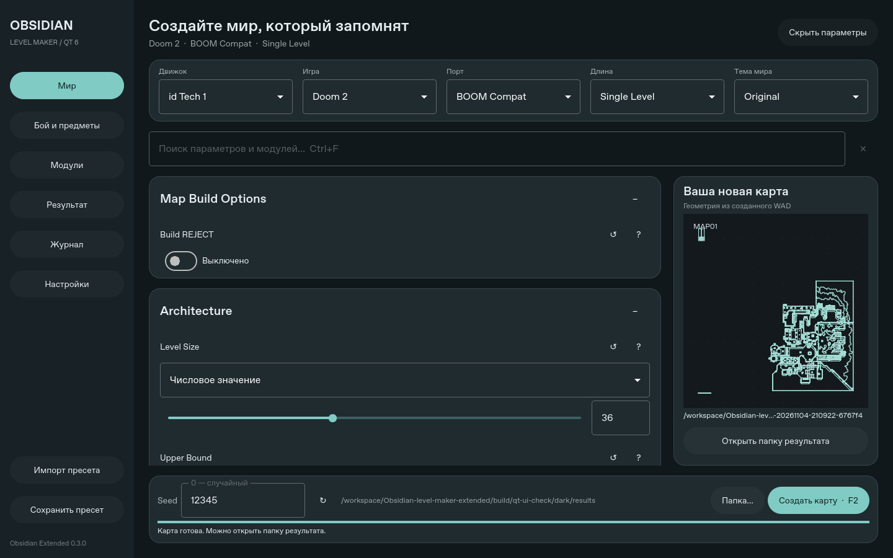
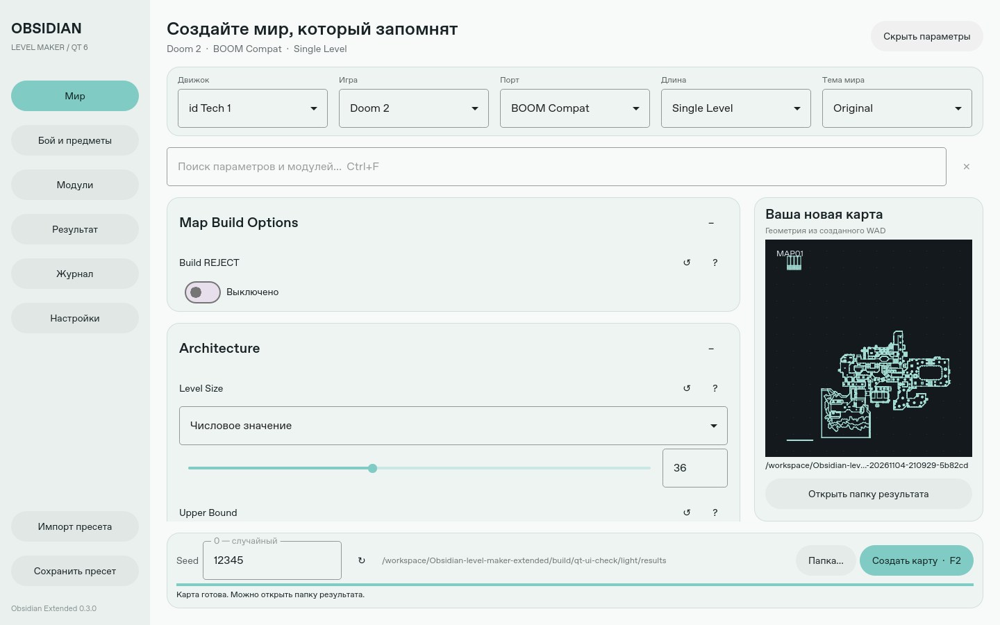

# Obsidian Extended · Qt 6

Генератор карт Doom и других поддерживаемых OBSIDIAN игр с новым нативным
интерфейсом **Qt 6 / Qt Quick Controls 2** в стиле Material.




## Что изменилось

- Разделы мира, боя, модулей, результата и журнала; поиск и сворачиваемые карточки.
- Настройки и совместимость берутся из существующего Lua-движка, включая дополнения.
- Светлая и тёмная схемы, акцент, масштабирование Qt, клавиатура и точный ввод.
- Генерация отдельным процессом с отменой; готовые карты, конфигурация и журнал
  сохраняются в новой папке. Предпросмотр показывает геометрию настоящего WAD.
- Импорт старых CONFIG.txt, экспорт пресетов, seed и управление дополнениями.

Алгоритмы генерации сохранены. План более запоминающихся и проходимых уровней:
[GENERATION_ROADMAP.md](docs/GENERATION_ROADMAP.md).

## Ubuntu

[Инструкция установки и сборки](docs/qt6/UBUNTU.md) ·
[GitHub Releases](https://github.com/Kostr2007/Obsidian-level-maker-extended/releases) ·
[CHANGELOG](CHANGELOG.md).

```sh
# После установки Qt/QML-зависимостей из инструкции:
./scripts/dev/build-linux.sh
./obsidian
```

Нужны Qt 6.4+, CMake, Ninja, C++17 и FLEX. Основная сборка не использует FLTK.
В архиве запускайте `./start.sh`, сохраняя бинарники и ресурсы вместе.

## Разработка

[Архитектура Qt](docs/qt6/ARCHITECTURE.md) · [Компиляция](COMPILING.md) ·
[Выпуск версий](docs/RELEASING.md).

Генератор доступен как `obsidian-engine`. Существующий вызов
`./obsidian --batch ...` также работает без окна. Историческая FLTK-сборка
доступна через `-DOBSIDIAN_QT=OFF`; старый THEME.txt не определяет оформление Qt.

## Происхождение и лицензия

Это самостоятельная модификация OBSIDIAN, не официальный релиз upstream.
Основа: `obsidian-level-maker/Obsidian`, ветка `obsidian`, commit
`f4c93451e10fd3ab13395dfb8e7b0416c1cd6633`. Авторы основы: Andrew Apted,
The OBSIDIAN Team и участники ObAddon. Их уведомления сохранены в исходниках,
[AUTHORS.md](AUTHORS.md) и [оригинальном README](docs/UPSTREAM_README.md).
Модификации интерфейса: Kostr2007 с помощью OpenAI Codex.
Лицензия программы — [GPL-2.0-or-later](LICENSE.txt); сторонние библиотеки,
включая Qt, сохраняют свои лицензии. Qt-библиотеки устанавливаются из пакетов Ubuntu.
