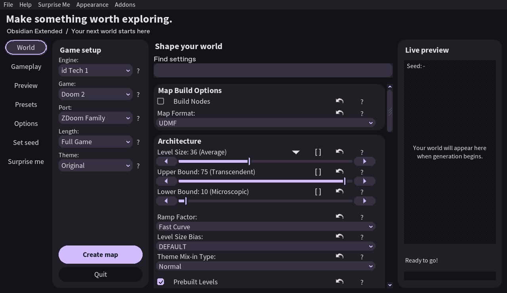
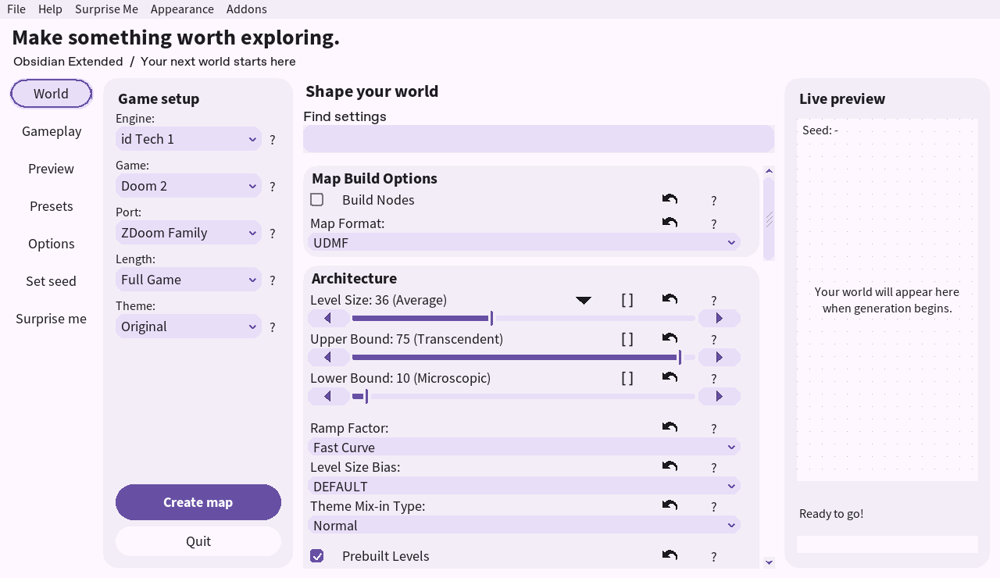
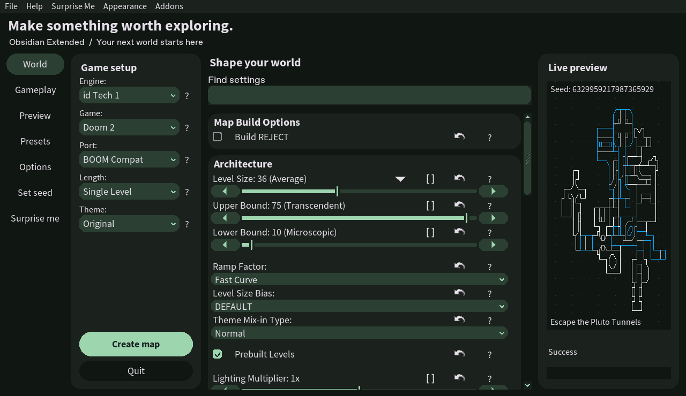

# Obsidian Extended · Material You

Развитие нативного интерфейса [OBSIDIAN Level Maker](https://github.com/obsidian-level-maker/Obsidian) от [Kostr2007](https://github.com/Kostr2007). Нативный генератор карт Doom с оформлением в духе **Material You / Material Design 3**.

## Оформление

- Новое рабочее пространство: World, Gameplay, поиск по настройкам и адаптивный предпросмотр.
- Светлая и тёмная схемы, четыре сохраняемые палитры: Violet, Sage, Ocean и Clay.
- Кнопки с состояниями наведения и фокуса, обновлённые слайдеры и checkbox.
- Скруглённые тональные карточки модулей и поля выбора, больше пространства между группами.
- Контрастная основная кнопка Build, спокойная сетка предпросмотра и индикатор фокуса у полей выбора.
- Переключение: **Appearance → Material You Dark / Material You Light / Classic and Custom**. Выбор сохраняется между запусками.
- Старые RGB-темы и редактор **File → Theme (F7)** сохранены. Загрузка старой темы включает её исходное оформление.





Это нативный интерфейс на FLTK. Автоматического извлечения цвета из обоев, системного переключения темы и анимаций пока нет. Алгоритмы генерации и игровые модули взяты из указанного ниже upstream без изменений.

Готовые сборки Ubuntu: [последний релиз](https://github.com/Kostr2007/Obsidian-level-maker-extended/releases/latest).
История изменений: [CHANGELOG.md](CHANGELOG.md). Порядок выпуска версий:
[RELEASING.md](docs/RELEASING.md).

## Сборка и запуск

Ubuntu / Debian:

```sh
sudo apt install build-essential cmake ninja-build flex libfontconfig1-dev libxft-dev libxinerama-dev libxcursor-dev libgl1-mesa-dev libglu1-mesa-dev
./scripts/dev/build-linux.sh
./obsidian
```

Подробная инструкция для Ubuntu и описание нового интерфейса: [UBUNTU.md](docs/material-you/UBUNTU.md).

Запускайте из каталога с `data`, `games`, `scripts` и остальными ресурсами. Для NixOS зависимости можно получить через `nix-shell -p cmake ninja gcc flex fontconfig libGL libGLU xorg.libX11 xorg.libXft xorg.libXinerama xorg.libXcursor xorg.libXrender`.

В **Actions → Material You** доступны проверка сборки, тест генерации WAD и архив Linux-приложения с ресурсами. Подробности остальных платформ — [COMPILING.md](COMPILING.md).

## Происхождение и лицензия

Это самостоятельная модификация, не официальный релиз OBSIDIAN. Основа: `obsidian-level-maker/Obsidian`, ветка `obsidian`, commit `f4c93451e10fd3ab13395dfb8e7b0416c1cd6633`. Указанный репозиторий больше не поддерживается авторами; его README указывает на [Obsidian-Content](https://github.com/GTD-Carthage/Obsidian-Content).

Авторы исходной программы: Andrew Apted, The OBSIDIAN Team и участники ObAddon. Их уведомления сохранены в исходниках, [AUTHORS.md](AUTHORS.md) и [оригинальном README](docs/UPSTREAM_README.md). Модификации интерфейса: Kostr2007, ноябрь 2026, с помощью OpenAI Codex. Лицензия программы — [GPL-2.0-or-later](LICENSE.txt); сторонние библиотеки сохраняют свои лицензии.

[Описание реализации и проверок](docs/material-you/IMPLEMENTATION.md)
