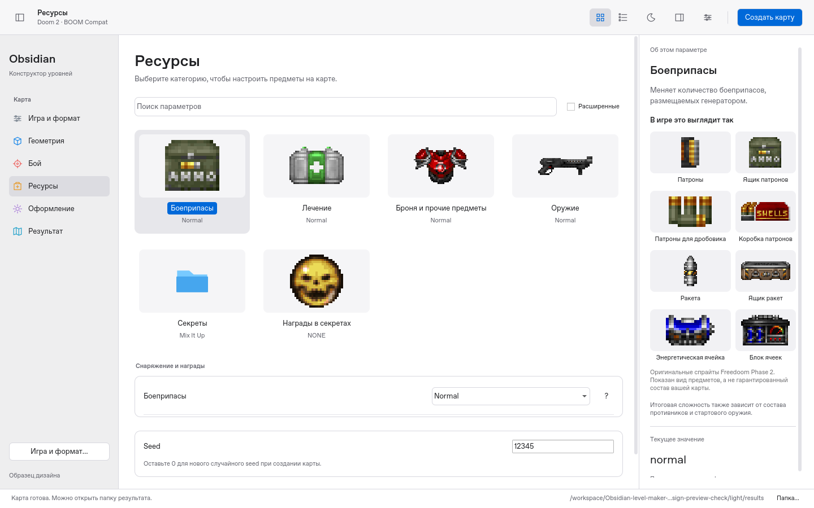
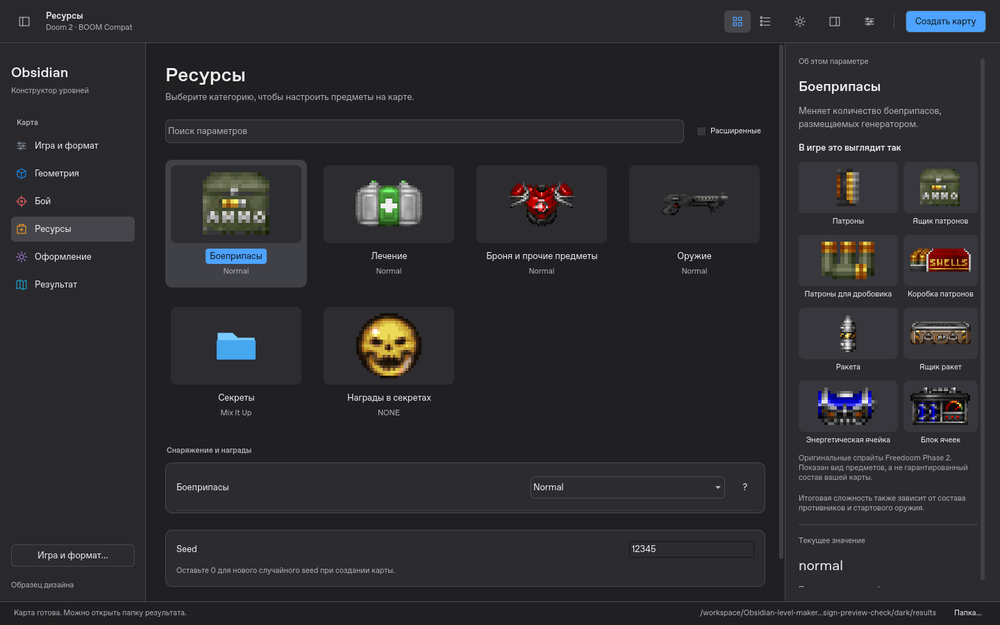

# Finder-inspired: работающий образец Qt

Реальные снимки и записи текущего приложения на Linux. Дизайн, ссылки HIG,
границы образца и инструкции: [MACOS_PREVIEW.md](../MACOS_PREVIEW.md).

## Движение

Это записи окна, сделанные ffmpeg, без дорисовки промежуточных кадров.

- [Переход между разделами: GIF](navigation-motion.gif) · [MP4](navigation-motion.mp4).
- [Раскрытие инспектора: GIF](inspector-motion.gif) · [MP4](inspector-motion.mp4).
- [Скрытие sidebar: GIF](sidebar-motion.gif) · [MP4](sidebar-motion.mp4).
- [Тот же переход с отключённым движением: GIF](reduced-motion.gif) · [MP4](reduced-motion.mp4).

Переходы разделов используют 90 ms затухания и 220 ms появления со смещением
12 px, панели — 240 ms. В меню есть «Меньше анимации» (Ctrl+Shift+M).
Записи: X11/Xvfb, software renderer, 30 кадров/с; GIF уменьшены до 960 px и 15
кадров/с для просмотра. Это не измерение производительности на всех GPU.

## Ресурсы и адаптация

- [Компактный список](resource-list.png), Ctrl+1/2 переключают представление.
- [Пример лечения](resource-health.png).
- [Те же предметы в инспекторе Studio](studio-ammo.png).
- [Масштаб дисплея 150%](hidpi.png).
- [Текст 125%, включая подписи спрайтов](large-text.png).
- [Минимальное окно 900×540](minimum.png).
- [Последняя карточка списка доступна с клавиатуры в маленьком окне](minimum-list-last.png).
- [Инспектор на небольшом экране](inspector.png).
- [Настоящая созданная карта](result.png).

22 оригинальных pickup-спрайта Freedoom встроены в приложение; установка IWAD
для просмотра не требуется. [Источник, лицензии и проверка извлечения](../../artwork/freedoom-assets/README.md).
Для Doom 1 не показывается двуствольный дробовик; для других семейств игр примеры
Freedoom скрыты. Выбор карточки не меняет значение параметра: настройка расположена
под галереей. Стрелки перемещают фокус с прокруткой, Enter открывает инспектор
на узком экране. Полные подписи выбранной категории доступны в инспекторе.

## Запуск и проверка

Из распакованной сборки: `./start.sh --design-preview`; из checkout:
`./obsidian --design-preview`. Обычный запуск открывает Studio.

QtTest: 13 passed, 0 failed на Qt 6.8.2 и Ubuntu 24.04 / Qt 6.4.2.
Проверены выбор карточек без изменения CONFIG, быстрые переходы, lifecycle
анимаций, режим уменьшенного движения, видимость фокуса в списке и PNG из qrc.
Скрипт `scripts/dev/check-design-preview.py --motion` воспроизводит снимки и видео.

[Светлая тема на Ubuntu](ubuntu-light.png) · [Тёмная тема на Ubuntu](ubuntu-dark.png).

Ubuntu-сборка дополнительно проверена после распаковки: `./start.sh
--design-preview --smoke-output …` создал настоящий WAD, отчёт — `success=true`,
Qt 6.4.2, 59 модулей. Финальные сценарии Preview прошли в light/dark/HiDPI;
предупреждений QML нет. В Ubuntu-журналах остаётся только стандартное сообщение
XDG_RUNTIME_DIR для контейнера без desktop session. Оба Ubuntu-снимка открыты
и визуально проверены.
