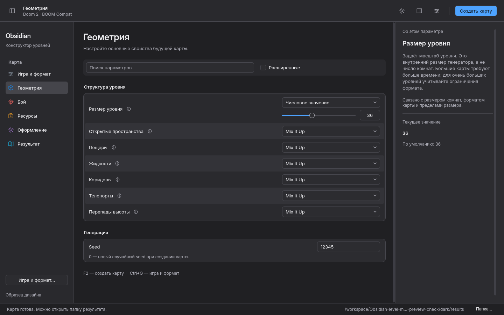
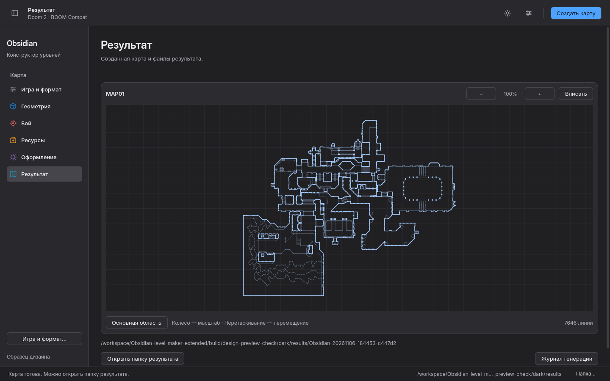

# Меню, движение и новый план результата

Итерация от 2026-11-06, после типографики Inter. Все изображения ниже — снимки
работающего приложения. Исходные игровые иллюстрации и алгоритмы генерации
не менялись.

## Строки настроек

Чередование спокойных оттенков по присланному референсу Finder помогает вести
взгляд от названия к значению. Границы каждой строки убраны; рамка группы,
информационная кнопка у подписи и компактная типографика сохранены.
Обычная строка — 46 логических px при 100%, строка с ползунком выше.

[До](before/geometry.png) · [Светлая тема](light/geometry.png) ·
[Тёмная тема](dark/geometry.png) · [HiDPI 150%](hidpi/geometry.png).

## План результата

Зелёная схема на отдельном фоне заменена планом в цветах интерфейса. Стены
контрастнее внутренних двусторонних линий; сетка остаётся второстепенной.
Пустой инспектор на странице результата скрыт, журнал свёрнут до запроса.

Колесо и кнопки меняют масштаб, перетаскивание перемещает план. После фокуса
на плане работают +/−, стрелки и Home/0 для вписывания. 100% — исходный
вписанный вид. По умолчанию отображается крупнейшая связная область;
кнопка «Вся геометрия» показывает все линии, включая удалённые служебные
участки. Это эвристика просмотра: отдельные игровые области тоже могут быть
несвязными. Геометрия файла не удаляется и не изменяется.

[Старый вид](before/result.png) · [Новый, светлый](light/result.png) ·
[Новый, тёмный](dark/result.png) · [После масштаба и перемещения](dark/result-zoom.png) ·
[Вся геометрия](dark/result-all.png) · [HiDPI](hidpi/result.png).

## Меню и подсказки

Меню команд имеет явную ширину и высоту содержимого: исчезновение пунктов в
тонкой полосе исправлено. Команды и сочетания клавиш выровнены в две колонки,
галочки состояния используют собственную иконку. Меню открывается кнопкой
или Ctrl+Shift+P; Escape закрывает его. Нативные бежевые подсказки заменены
общим компонентом с Inter и цветами темы.

[Меню: светлое](light/commands-menu.png) · [Тёмное](dark/commands-menu.png) ·
[HiDPI](hidpi/commands-menu.png) · [Светлая подсказка](light/tooltip.png) ·
[Тёмная подсказка](dark/tooltip.png).

## Реальные записи движения

Меню, списки и диалоги используют прозрачность и небольшой масштаб: 170 ms
появление, 110 ms закрытие. Стрелка списка и ползунок переключателя — 120 ms.
«Меньше анимации» / Ctrl+Shift+M обнуляет эти переходы, как и переходы страниц
и панелей. Статические снимки не используются как доказательство движения.

- Меню команд: [GIF](light/commands-motion.gif) · [MP4](light/commands-motion.mp4).
- «Игра и формат»: [GIF](light/dialog-motion.gif) · [MP4](light/dialog-motion.mp4).
- Выпадающий список: [GIF](light/dropdown-motion.gif) · [MP4](light/dropdown-motion.mp4).
- Тот же диалог с уменьшенным движением: [GIF](light/dialog-reduced-motion.gif) ·
  [MP4](light/dialog-reduced-motion.mp4).

Записи сделаны ffmpeg из окна X11/Xvfb с software renderer при 30 кадрах/с.
GIF уменьшены до 960 px и 15 кадров/с; промежуточные кадры не дорисовывались.
Это проверка поведения в этой конфигурации, не измерение FPS на всех GPU.

## Проверки

- Qt 6.8.2 и Ubuntu 24.04 / Qt 6.4.2: сборка, QtTest **14 passed, 0 failed**.
  Настоящий щелчок открывает меню и диалог; проверяются размеры, загрузка Inter,
  события прозрачности, отключение движения и смена WAD/масштаба.
- Studio: настоящее окно, обе темы, генерация по F2, поиск, размер и выход.
- Preview: светлая/тёмная темы и HiDPI 150%, генерация настоящего WAD,
  меню/диалоги, поиск, ресурсная галерея, минимальное окно 900×540,
  текст 125%, масштабирование и перемещение плана.
- Регрессия Qt 6.4: поиск сразу после результата во время раскрытия инспектора.
  Динамические строки помещены в стабильный Column вне кеша внешнего Layout;
  сценарий повторяется в QtTest и GUI-проверке.
- Итоговые снимки Ubuntu открыты и проверены: [строки](ubuntu/dark/geometry.png),
  [план](ubuntu/dark/result.png), [меню](ubuntu/dark/commands-menu.png),
  [подсказка](ubuntu/light/tooltip.png), [HiDPI](ubuntu/hidpi/result.png).

Воспроизведение: `scripts/dev/check-design-preview.py --motion`.
Обычная CI-проверка запускается без ffmpeg. Проверки не охватывают screen reader,
нативный Wayland/macOS или все физические дисплеи; план не проверяет проходимость.

Запуск образца: `./start.sh --design-preview` из распакованной сборки.
Обычный запуск по-прежнему открывает Studio.
