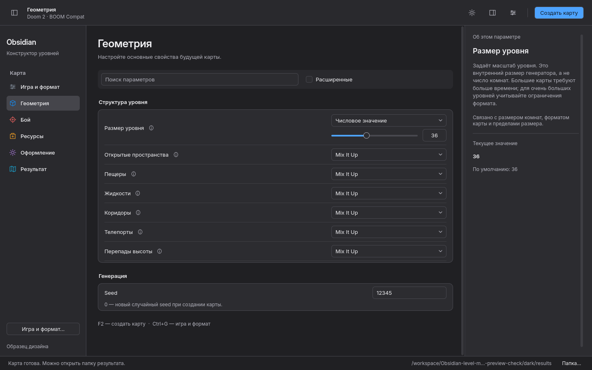

# Типографика и единый стиль: до и после

Все PNG — реальные снимки приложения. Они не ретушировались и не перерисовывались.
[Интерактивное сравнение](compare.html) переключает старую и новую версии в одной
позиции. Для оценки мелкого текста включите 1:1 и масштаб браузера 100%.

| Экран | До | После |
| --- | --- | --- |
| Геометрия, тёмная тема | [Снимок](before/dark/geometry.png) | [Снимок](after/dark/geometry.png) |
| Геометрия, светлая тема | [Снимок](before/light/geometry.png) | [Снимок](after/light/geometry.png) |
| Настройка игры | [Снимок](before/dark/project.png) | [Снимок](after/dark/project.png) |
| Диалог настройки | [Снимок](before/dark/game-dialog.png) | [Снимок](after/dark/game-dialog.png) |

## Что проверяли глазами

- Главный заголовок Inter Display 26/600 сохраняет приоритет, бренд 18/600 его
  поддерживает. Названия групп Inter 13/600 заметнее старых мелких подписей.
- Основной текст 13/400 и пояснения 12/400 читаются в обеих темах. Статические
  Text/Display-начертания не требуют установленного Inter или variable axes.
- [Текст 125%](after/dark/geometry-large-text.png) и [дисплей 150%](after/hidpi/geometry.png):
  сохраняются веса и роли, длинные пояснения переносятся, доступна прокрутка.
- [Раскрытый список](after/light/engine-popup.png), [диалог игры](after/dark/game-dialog.png)
  и [сравнение снимков](after/dark/monsters-comparison.png) используют согласованные
  поля, кнопки и скругления. Сравнение около 560 px высотой при окне 1440×900;
  снимки сохраняют 16:9, большой пустой нижней области нет.
- Обычные строки — 47 логических px, поля — 30; сложная строка с ползунком выше.
  Информация находится рядом с названием, Seed входит в раздел «Генерация».

## Ubuntu и функциональная проверка

[Геометрия на Ubuntu](ubuntu/dark/geometry.png) · [Диалог игры](ubuntu/light/game-dialog.png)
· [Сравнение](ubuntu/dark/monsters-comparison.png).

Qt 6.8.2 и Ubuntu 24.04 / Qt 6.4.2: QtTest 13 passed / 0 failed, реальные
семейства Inter/Inter Display и кириллица проверены QRawFont, роли и увеличение
текста — QFontInfo. Проверены native ComboBox commit/cancel, реальные нажатия
footer OK/Close, поиск, сохранение значений и генерация WAD.

Qt6.4-сбой при сужении закрытого окна сравнения устранён: адаптивная пара снимков
использует Flow и стабильные два элемента вместо изменения вложенного GridLayout.
Регрессия воспроизводит закрытие сравнения и два цикла 900×540 ↔ 1440×900.
GUI-сценарий контролирует процессы и таймаут снимка, чтобы авария выводила журнал
и сигнал, а не оставляла ожидание ImageMagick.

[Роли и официальные источники HIG](../TYPOGRAPHY.md) · [Inter OFL](../../artwork/fonts/README.md).
Запуск: `./start.sh --design-preview` из распакованного Ubuntu-архива.
